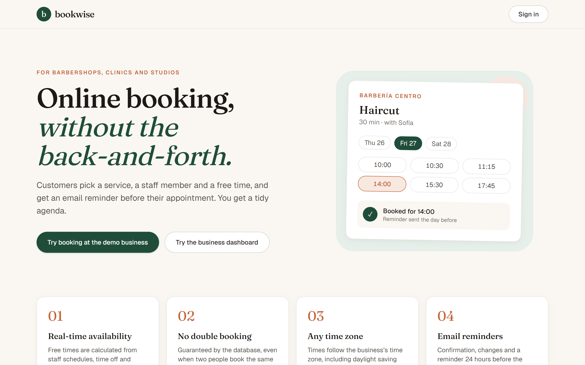
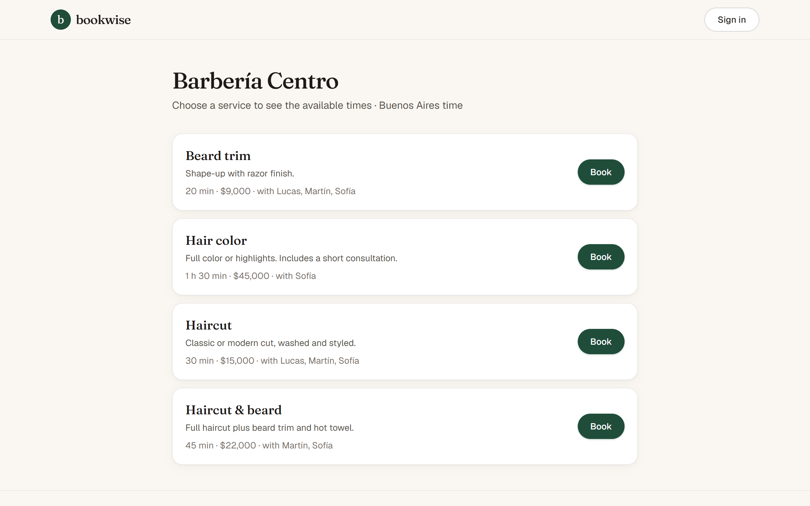
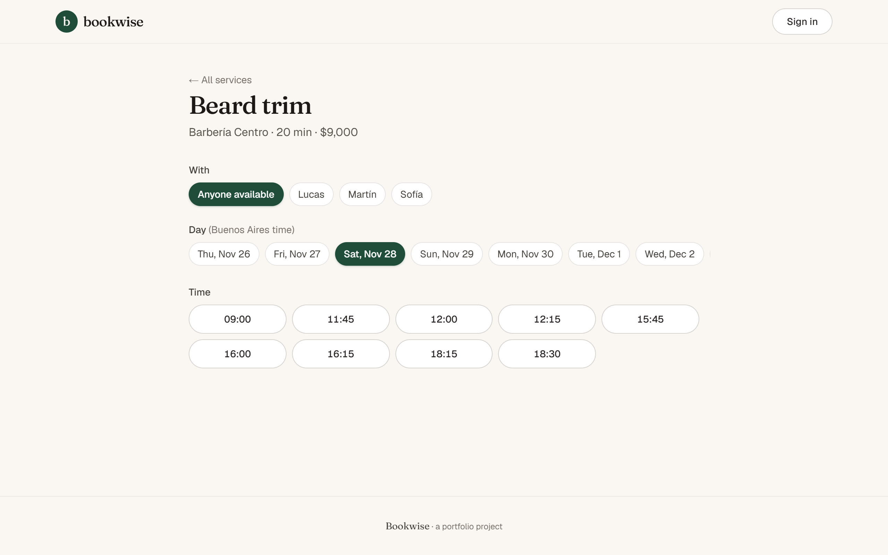
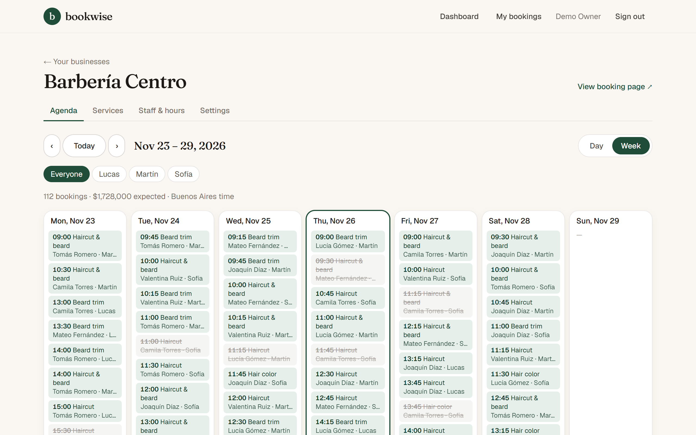
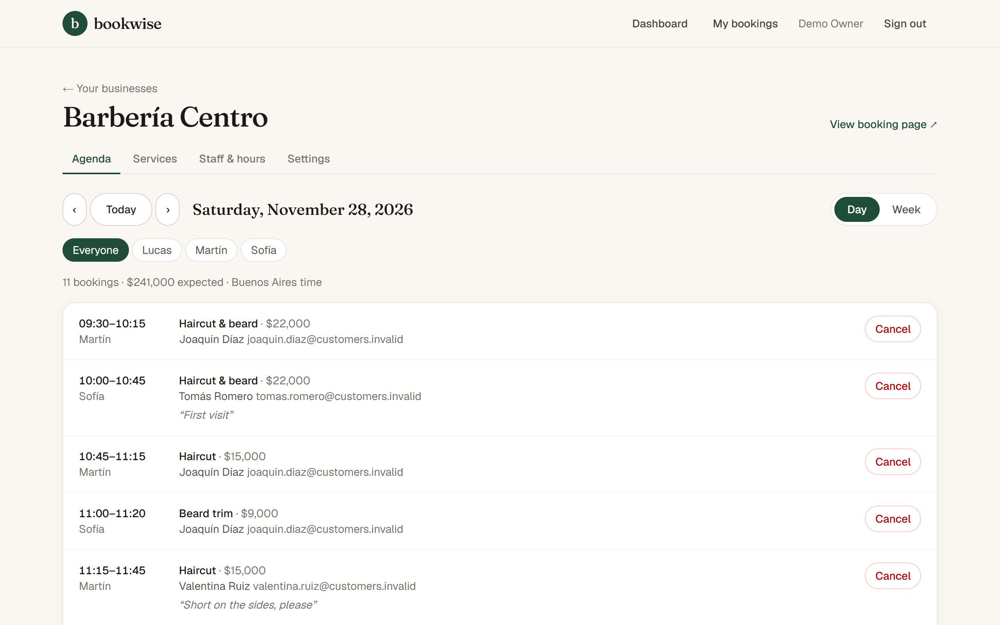

# Bookwise

**Multi-tenant appointment booking platform.** Businesses (barbershops, clinics, sports courts) publish their services and staff schedules; customers book available time slots online.

> 🚧 Work in progress. The project is built in stages; see the [roadmap](#roadmap).

## Screenshots

With the demo business, Barbería Centro ([run it yourself](#try-the-production-stack-locally)).



| Customers: pick a service                                               | Customers: pick a free time                                     |
| ----------------------------------------------------------------------- | --------------------------------------------------------------- |
|  |  |
| **Business: week agenda**                                               | **Business: day agenda**                                        |
|                      |  |

## Tech stack

| Layer    | Technology                                                |
| -------- | --------------------------------------------------------- |
| API      | **NestJS 12** (TypeScript, ESM)                           |
| Database | **PostgreSQL 17** with **Prisma 7**                       |
| Queues   | **Redis** + **BullMQ** (reminders)                        |
| Web      | **Next.js 16** + Tailwind CSS 4                           |
| Testing  | **Vitest** + Supertest, e2e tests against a real Postgres |
| Tooling  | Docker Compose, oxlint, Prettier, GitHub Actions          |

## Project structure

```
bookwise/
├── apps/
│   ├── api/                 NestJS REST API
│   │   ├── prisma/          Schema and migrations
│   │   ├── src/
│   │   │   ├── auth/        Sign-up, sign-in, token rotation, JWT guard
│   │   │   ├── users/       Users and GET /me
│   │   │   ├── businesses/  Businesses (tenants), members, tenant guard, public profile
│   │   │   ├── services/    Catalog of bookable services
│   │   │   ├── staff/       Staff members, weekly working hours, time off
│   │   │   ├── availability/ Availability engine (pure function) and public endpoint
│   │   │   ├── bookings/    Bookings: create, cancel, reschedule, agenda
│   │   │   ├── notifications/ Email queue: worker, reminders, sweep
│   │   │   ├── demo/        Public demo business: data, nightly reset, CLI
│   │   │   ├── mail/        SMTP email sending (nodemailer)
│   │   │   ├── common/      Shared helpers (time, slugs, Prisma errors)
│   │   │   ├── config/      Environment validation (Zod)
│   │   │   ├── health/      GET /health (liveness + database check)
│   │   │   └── prisma/      Prisma client as a Nest provider
│   │   ├── test/            e2e tests
│   │   └── Dockerfile       Production image (build and runtime stages)
│   └── web/                 Next.js app (talks to the API from the server only)
│       └── src/
│           ├── app/
│           │   ├── b/[slug]/    Public booking page: service, staff, day, time
│           │   ├── bookings/    Booking details, cancel and reschedule
│           │   ├── me/          The signed-in customer's bookings
│           │   ├── dashboard/   Business dashboard: agenda, services, staff & hours, settings
│           │   └── (auth)/      Sign-in and sign-up
│           ├── components/      Shared UI
│           └── lib/             API client, cookie sessions, formatting, agenda helpers
├── deploy/                  Production stack: Docker Compose, Caddy, env example
├── docker/                  Docker init scripts
├── docker-compose.yml       Postgres, Redis and Mailpit for local development
└── .github/workflows/       CI
```

## Getting started

Requirements: **Node.js 24+** and **Docker**.

```bash
# 1. Install dependencies (also generates the Prisma client)
npm install

# 2. Start Postgres, Redis and Mailpit
npm run db:up

# 3. Create the API environment file
cp apps/api/.env.example apps/api/.env

# 4. Run the API in watch mode
npm run dev

# 5. In another terminal: create the web environment file and run the web app
cp apps/web/.env.example apps/web/.env.local
npm run dev:web
```

The web app runs at **http://localhost:3000**. The API runs at http://localhost:3001, with interactive docs (Swagger) at **http://localhost:3001/docs**. Check it with:

```bash
curl http://localhost:3001/health
```

When you change `prisma/schema.prisma`, create a migration with:

```bash
npm run prisma:migrate -w apps/api -- --name describe_the_change
```

### Local services

| Service  | Address               | Notes                                                              |
| -------- | --------------------- | ------------------------------------------------------------------ |
| Web      | http://localhost:3000 |                                                                    |
| API      | http://localhost:3001 |                                                                    |
| Postgres | `localhost:5434`      | user/password `bookwise`, databases `bookwise` and `bookwise_test` |
| Redis    | `localhost:6379`      | Database 0 for development, 1 for the e2e tests                    |
| Mailpit  | http://localhost:8025 | Inbox for every email sent locally                                 |

## Scripts

Run from the repository root:

| Command                          | What it does                                       |
| -------------------------------- | -------------------------------------------------- |
| `npm run dev`                    | API in watch mode                                  |
| `npm run dev:web`                | Web app in development mode                        |
| `npm run build`                  | Production build                                   |
| `npm run lint`                   | oxlint (type-aware)                                |
| `npm run typecheck`              | TypeScript, no emit                                |
| `npm test`                       | Unit tests                                         |
| `npm run test:e2e`               | e2e tests against the `bookwise_test` database     |
| `npm run format`                 | Prettier                                           |
| `npm run db:up` / `db:down`      | Start / stop the Docker services                   |
| `npm run demo:reset -w apps/api` | Recreate the demo business (after `npm run build`) |

## API

| Method | Path             | Auth   | Description                                   |
| ------ | ---------------- | ------ | --------------------------------------------- |
| GET    | `/health`        | Public | API and database status                       |
| POST   | `/auth/register` | Public | Create an account, returns a token pair       |
| POST   | `/auth/login`    | Public | Sign in, returns a token pair                 |
| POST   | `/auth/refresh`  | Public | Exchange a refresh token for a new token pair |
| POST   | `/auth/logout`   | Public | Revoke the session of a refresh token         |
| GET    | `/me`            | Bearer | The signed-in user                            |

**Businesses** (`/businesses/:businessId/...` requires membership; writes require the `OWNER` role)

| Method              | Path                                                           | Description                                   |
| ------------------- | -------------------------------------------------------------- | --------------------------------------------- |
| POST / GET          | `/businesses`                                                  | Create a business (you become owner) / yours  |
| GET / PATCH         | `/businesses/:businessId`                                      | Read / edit name, slug, time zone             |
| GET / POST          | `/businesses/:businessId/members`                              | List / add an existing user by email          |
| PATCH / DELETE      | `/businesses/:businessId/members/:userId`                      | Change role / remove (always keeps one owner) |
| GET / POST          | `/businesses/:businessId/services`                             | List / create services                        |
| PATCH / DELETE      | `/businesses/:businessId/services/:serviceId`                  | Edit / archive a service                      |
| GET / POST          | `/businesses/:businessId/staff`                                | List / create staff members                   |
| PATCH / DELETE      | `/businesses/:businessId/staff/:staffId`                       | Edit / deactivate a staff member              |
| GET / PUT           | `/businesses/:businessId/staff/:staffId/working-hours`         | Read / replace the weekly schedule            |
| GET / POST / DELETE | `/businesses/:businessId/staff/:staffId/time-off[/:timeOffId]` | Time off (vacations, appointments)            |
| GET                 | `/public/businesses/:slug`                                     | Public profile for the booking page           |
| GET                 | `/public/businesses/:slug/availability`                        | Free slots for a service between two dates    |

**Bookings** (visible to their customer and to members of the business)

| Method | Path                                | Description                                         |
| ------ | ----------------------------------- | --------------------------------------------------- |
| POST   | `/bookings`                         | Book a slot (optionally with a chosen staff member) |
| GET    | `/me/bookings?scope=upcoming\|past` | The signed-in user's bookings                       |
| GET    | `/bookings/:bookingId`              | One booking                                         |
| POST   | `/bookings/:bookingId/cancel`       | Cancel a future booking (frees the slot)            |
| POST   | `/bookings/:bookingId/reschedule`   | Move to another time or staff member, atomically    |
| GET    | `/businesses/:businessId/bookings`  | The business agenda between two local dates         |

Every endpoint requires `Authorization: Bearer <access token>` unless it is marked public. Request bodies are validated with Zod; invalid input returns `400` with one message per field. The full reference, with request and response schemas, is at `/docs`.

## Design decisions

### Authentication

Built from small pieces (`@nestjs/jwt`, argon2) instead of an all-in-one library, so every step is explicit:

- **Access token:** a JWT signed with HS256 that expires in 15 minutes. It is verified by a global guard without touching the database; routes opt out with `@Public()`.
- **Refresh token:** a random 256-bit string, valid for 30 days. The database stores only its **SHA-256 hash**, so a database leak doesn't expose usable tokens.
- **Rotation with reuse detection:** every refresh revokes the token used and issues a new one in the same _family_ (one family per sign-in). If a revoked token shows up again, it was probably stolen, so the whole family is revoked and that session has to sign in again. Other devices stay signed in.
- **Race-safe rotation:** the token is revoked with a compare-and-set (`UPDATE ... WHERE revoked_at IS NULL`), so when several requests use the same token at the same time, exactly one wins. An e2e test fires simultaneous refreshes to prove it.
- **Passwords:** hashed with **argon2id**. Sign-in returns the same error for an unknown email and a wrong password, and verifies against a dummy hash when the email doesn't exist, so response times don't reveal which emails are registered.
- **Rate limiting:** 10 requests per minute per IP on the auth endpoints (`@nestjs/throttler`).

### Multi-tenancy

Every business is a tenant, and every catalog record belongs to one business.

- **Two layers of isolation:** a guard checks that the user is a member of the business in the URL (and has the required role), and every query is also scoped by `businessId`. Being an owner of business B doesn't give access to a service of business A through B's URLs.
- **404, not 403, for outsiders:** a non-member gets the same response as for a business that doesn't exist, so business ids can't be probed. Members without the right role get `403`.
- **Always one owner:** demoting or removing an owner first counts the remaining owners. That check runs inside a transaction that locks the business row (`SELECT ... FOR UPDATE`): without the lock, two owners removing each other at the same time both saw "2 owners" and left the business with none (reproduced in 29 of 30 attempts before the fix). An e2e test covers it.
- **Archive, don't delete:** services and staff are deactivated instead of deleted, because bookings will reference them.

### Data integrity

- **Database CHECK constraints** back the API validation (durations, prices, weekdays, intervals, slug format), so invalid rows can't be written even by a bug or a manual query.
- **Money in cents** (integers), never floating point.
- **Working hours in local time:** stored as minutes since midnight in the business's time zone (09:30 → 570) and exchanged as `"HH:mm"`. Several intervals per day are allowed (split shifts); overlapping intervals are rejected.

### Availability engine

`GET /public/businesses/:slug/availability?serviceId=...&from=2026-12-07&to=2026-12-13` returns the free slots for a service. The calculation lives in a **pure function** (`computeAvailableSlots`, no database access), so it is covered by fast unit tests; the service around it only loads data and calls it.

- **Two kinds of time:** working hours are _wall-clock_ times in the business's time zone ("Mondays 09:00-13:00"), because that's how businesses think. Time off, bookings and slots are _instants_ in UTC, because that's what can be compared safely. Wall-clock times are turned into instants day by day, in the business's zone (with Luxon).
- **Daylight saving time:** "09:00" stays 09:00 local time all year, while its UTC instant moves when clocks change. On the spring-forward day the skipped hour offers no slots; on the fall-back day the repeated hour is offered twice, because it really happens twice. Both cases are unit tested with `America/New_York`.
- **Rules:** candidate starts every 15 minutes; the appointment must end by closing time (the buffer may spill over); a slot is dropped if the appointment plus its buffer overlaps time off or another booking (periods are half-open, so back-to-back appointments fit); only future slots are offered.
- **Any staff member:** each slot lists every staff member free at that time, so the customer can pick one or let the business assign anyone.
- **Bounded queries:** at most 31 days per request, and busy periods are loaded only for that window.

### Bookings: no double booking

The hardest guarantee of the system: **two confirmed bookings of the same staff member never overlap**, even when requests race for the same slot.

- **Enforced by Postgres, not only by the API:** an exclusion constraint rejects overlapping ranges at insert/update time:
  ```sql
  EXCLUDE USING gist (staff_id WITH =, tstzrange(starts_at, blocked_until, '[)') WITH &&)
  WHERE (status = 'CONFIRMED')
  ```
  Checking availability first and then inserting is not enough: concurrent requests all pass the check before any of them writes. With the constraint, the database lets exactly one in and the others fail with `23P01`, which the API turns into `409`. The ranges include the service buffer and are half-open (`[)`), so back-to-back bookings fit and cancelled bookings don't block.
- **Proven by a test:** 10 simultaneous booking attempts for the same slot end in exactly 1 booking and 9 `409`s. With the constraint temporarily dropped, the same test produced **10 bookings for one slot**.
- **Deadlocks are retried:** concurrent inserts competing for the same constraint can deadlock each other (`40P01`); Postgres aborts one of them. The insert is retried a few times with a short random pause, and then answers `409`. It only shows up under real concurrency: before adding the retry, 8 rounds of 10 parallel requests produced 18 deadlocks.
- **The availability engine is the first filter:** a booking must match a slot it offers (working hours, time off, other bookings, future only, 15-minute alignment), so the constraint is the last line of defense, not the only one.
- **"Any staff member":** when the customer doesn't choose, the first free staff member is booked; if someone takes that person a moment earlier, the next free one is tried.
- **Atomic reschedule:** a single `UPDATE` moves the booking; if the new time is taken, nothing changes. The booking is excluded from its own availability check, so it can move into a time that overlaps its current one.
- **Price snapshot:** a booking stores the service's name, duration and price at booking time, so later catalog changes don't rewrite history.

### Notifications: queue and email reminders

Customers get an email when a booking is confirmed, rescheduled or cancelled, and a **reminder 24 hours before** (configurable with `REMINDER_HOURS_BEFORE`).

- **Through a queue (BullMQ + Redis), not inside the request:** the booking answers immediately, and a worker sends the email. If the SMTP server is slow or down, the worker retries with exponential backoff (5 attempts: 2 s, 4 s, 8 s...). Enqueueing never fails the booking itself.
- **Reminders are delayed jobs:** one job per booking, with a deterministic id (`reminder-<bookingId>`), delayed until 24 hours before the start. Cancelling removes it; rescheduling replaces it. Bookings made less than 24 hours ahead get no reminder (the confirmation is enough).
- **At most once:** jobs can run more than once (retries, the sweep below), so the worker first _claims_ the booking with a conditional update (`status = CONFIRMED`, same start the reminder was scheduled for, `reminder_sent_at IS NULL`) and only then sends. A second run finds nothing to claim. If the email fails, the claim is released so a retry can send it. A stale reminder (booking cancelled or moved) is skipped the same way.
- **Never lost:** if Redis was down when a booking was made, its reminder was never queued. A **sweep** runs every 10 minutes (a BullMQ job scheduler) and queues reminders for confirmed bookings inside the window that should have one and don't.
- **Tested end to end:** the e2e tests send real emails through SMTP to Mailpit and read them back through its API, including a failed send (released claim, then a successful retry) and a lost reminder recovered by the sweep.

Locally, every email lands in Mailpit at http://localhost:8025. The e2e tests use Redis database 1, so they never touch the development queues.

### Dates

Every timestamp is stored as `timestamptz` (UTC); local times only exist at the edges (working hours in, labels out).

### Public demo

The demo business, **Barbería Centro**, is a real tenant: anyone can book at it, and anyone can open its dashboard as its owner from the home page.

- **Reset every night:** visitors can rename it, change its hours or cancel bookings, so a BullMQ job scheduler recreates it at 04:00 (Buenos Aires) in one transaction. The business keeps a fixed id, so dashboard links survive. On the first deploy it is created at startup.
- **Looks lived-in:** three staff members with different hours and about two weeks of past and upcoming bookings, around 40% of the possible start times, so there are still free slots to book. The data is a pure function of the date (seeded hashes), tested for no overlaps and only inside working hours.
- **No emails to strangers:** seeded customers use the reserved `.invalid` domain (RFC 2606), and the mail service never sends to it. Visitors who book with their own address get real emails.

### Production behind a reverse proxy

- **Only Caddy is public:** it terminates HTTPS (automatic certificates) and forwards to the web app and, for the interactive docs, to the API. Postgres and Redis are only on the internal Docker network.
- **Rate limits per visitor, not per server:** the web app calls the API from its own server, so every request reaches the API from the same address, and the sign-in limit (10 per minute per IP) would be shared by everyone. The web app passes on the visitor's `X-Forwarded-For`, and the API trusts that header only from private network addresses (`TRUST_PROXY`). Caddy overwrites whatever value the visitor sends, so it can't be spoofed: checked against the running stack (a forged header still gets `429` after 10 attempts, while two different visitors are limited separately).
- **Small images:** the API runtime image has production dependencies only; the web image uses Next.js `standalone` output, which traces the files the server needs. CI builds both images on every push.
- **Migrations before the API starts:** a one-shot `migrate` service runs `prisma migrate deploy`, and the API waits for it to succeed.

## Deployment

The production stack runs on any server with Docker (for example a small VPS with 2 GB of RAM or more; building the images needs it). Everything is in [`deploy/`](deploy):

1. Point two DNS records (for example `bookwise.example.com` and `api.bookwise.example.com`) to the server.
2. On the server, clone the repository and create the settings file:
   ```bash
   cd deploy
   cp .env.example .env   # fill in domains, secrets, SMTP and the demo owner
   ```
3. Start everything:
   ```bash
   docker compose up -d --build
   ```
   Caddy gets the HTTPS certificates, `migrate` applies the migrations, and the API creates the demo business.
4. To update: `git pull && docker compose up -d --build`.

Emails go through any SMTP provider (Resend, Postmark...), with the sender's domain verified there. Other useful commands, from `deploy/`:

```bash
docker compose logs -f api                      # API and email worker logs
docker compose exec api node dist/demo/reset-demo.js   # reset the demo now
docker compose exec postgres pg_dump -U bookwise bookwise > backup.sql
```

### Try the production stack locally

The same stack runs on your machine, with the demo business, without a server or a domain: Caddy serves `localhost` with a certificate from its own local authority (the browser shows a warning the first time), and emails go to the development Mailpit.

1. Start Mailpit: `npm run db:up` from the repository root.
2. In `deploy/`, create `.env` from `.env.example` with these values, plus random values for `POSTGRES_PASSWORD`, `JWT_ACCESS_SECRET` and `DEMO_OWNER_PASSWORD`:
   ```
   DOMAIN=localhost
   API_DOMAIN=api.localhost
   SMTP_URL=smtp://host.docker.internal:1025
   MAIL_FROM=Bookwise <no-reply@bookwise.local>
   DEMO_OWNER_EMAIL=demo@bookwise.test
   ```
3. `docker compose up -d --build`, then open https://localhost and use the home page buttons to book or to open the demo dashboard. Stop it with `docker compose down` (add `-v` to delete its data).

It uses ports 80 and 443 and its own project name (`bookwise-prod`), so it doesn't touch the development containers.

## Roadmap

- [x] **Stage 0:** monorepo, Docker services, NestJS API with health check, Prisma, CI
- [x] **Stage 1:** users and authentication (JWT access + rotating refresh tokens)
- [x] **Stage 2:** businesses (multi-tenant), services, staff and working hours
- [x] **Stage 3:** availability engine with time zones
- [x] **Stage 4:** bookings without double booking (Postgres exclusion constraint)
- [x] **Stage 5:** email reminders with BullMQ
- [x] **Stage 6:** web: booking flow
- [x] **Stage 7:** web: business dashboard
- [x] **Stage 8:** production deployment (Docker Compose + Caddy) and a resettable demo business
- [ ] **Stage 9:** AI booking assistant
